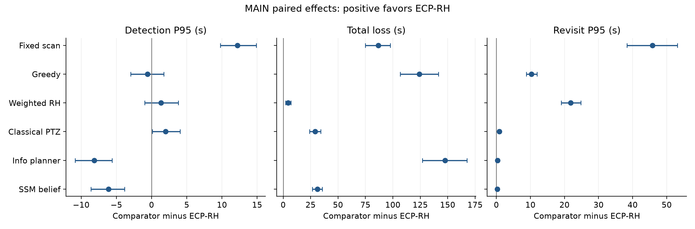
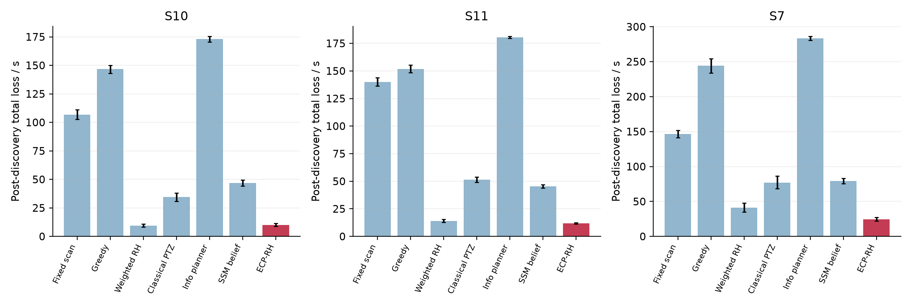
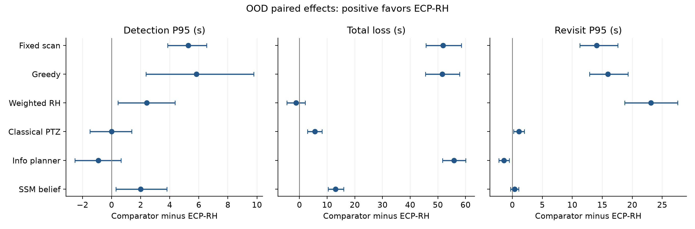
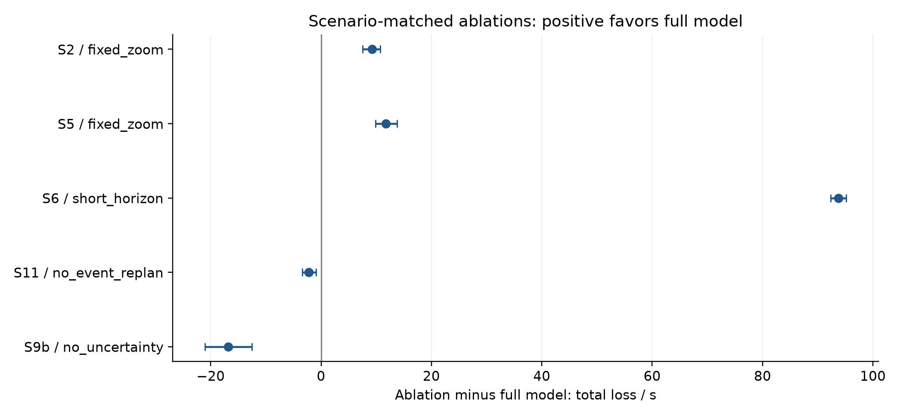
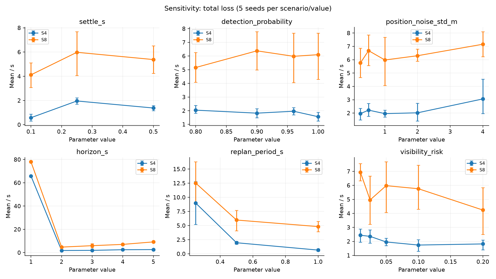
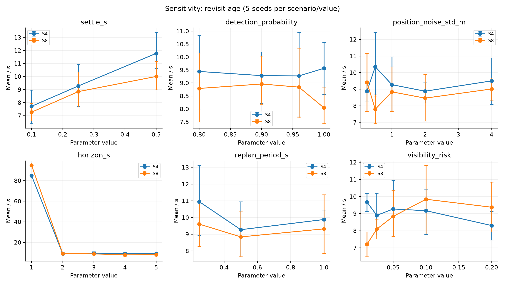
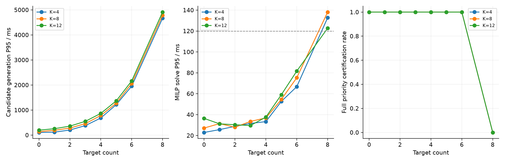

# ECP RH 协同搜索与持续监视完整实验报告

geometry v2 冻结实验的设计 方法 结果分析与复现材料

报告日期：2026年10月25日。研究版本：`geometry-v2-central-roi-20261024`。证据源提交：`94b30f4d100532779d2d25158b8a2e2fd607e05f`。

## 摘要

本报告研究四台固定位置的定向光电设备如何在三维任务区域内协同搜索未知目标，并对已发现目标持续监视。实验统一了任务几何、虚拟感知、设备执行模型、参数选择和评价协议，比较ECP-RH与六种工程或思想适配基线。正式数据包括960次验证集调参、560次主测试、280次分布外测试、415次机制消融、250次局部敏感性实验，以及24个规模点、每点10次的规划计时基准。所有结论以冻结数据和当时的实际代码行为为依据。

主要证据支持ECP-RH在本轮固定场景面板中的持续监视与失观控制优势，但不支持所有指标同时占优。在包含无目标场景的主测试总体中，ECP-RH累计失观均值为11.6463 s，Weighted RH为16.1513 s；相应配对优势为4.505 s。ECP-RH的最长失观间隔总体均值为1.2650 s。两项指标相对六个比较方法的总体配对差异均通过各指标内部的Holm校正。与此同时，其含删失发现延迟P95均值12.1828 s，慢于Information Planner的4.0391 s和SSM Belief的6.0631 s；各方法总体漏检率很低，不能把本轮结果写成漏检率普遍显著改善。

机制证据应作区分解释。忽略执行过程会造成严重发现失败，说明执行模型对这套感知就绪逻辑十分关键；但去掉不确定性裕量或事件重规划在特定场景中反而改善失观指标，因此不能将每个模块的贡献都描述为单向正收益。扩展性数据还表明候选生成时间可能远大于0.12 s的MILP预算，求解器“未超时”不足以证明整个规划循环实时。报告据此同时呈现有利与不利结果、统计适用范围、实现口径及复现限制。

## 阅读顺序与证据层次

第1至3节说明问题、公共参数和场景；第4至5节给出七种方法的实际实现与冻结参数；第6至8节定义指标、辅助实验和复现入口；第9至14节展示主测试、OOD、消融、敏感性、扩展性及综合判断；第15节提供材料索引、哈希核验和归档说明。表格保留明确单位、样本量和统计口径；论文写作时应连同相应限制使用，而不是只摘取显著结果。

报告区分三种证据：逐运行源CSV与原始日志构成观测数据；从这些数据生成的均值、配对差异与区间构成统计证据；对机制与适用性的解释属于分析判断。代码核查发现的口径差异会明确披露，不通过修改旧数据或悄悄变更算法来消除差异。当前正式结果是受控虚拟感知下的仿真研究，现场标定与真实感知闭环尚不能由这些结果替代。

资料包同时保留原始结果目录、完整源代码快照、53个正式运行数据包、派生表图、生成脚本和文件校验清单。报告与派生分析不改变原始实验的任何记录。


## 1. 研究任务、问题边界与验证目标

研究对象是四台位置固定、视轴和变焦可调的定向光电设备。设备既要反复搜索预先规定的三维区域，以发现未知进入的目标，又要在发现之后尽可能持续提供有效监视。调度器每次输出各设备的方位角、俯仰角和倍率。设备数量有限，且转动、变焦与稳定过程暂时占用感知能力，因此“分配给已知目标的资源”与“保留给未知区域的资源”形成竞争。

正式实验采用虚拟目标世界、虚拟感知和受限 PTZ 执行模型。调度器接收匿名轨迹的位置、速度、协方差、观测设备集合及公共搜索龄场；目标真值、真实身份、未来进入时刻和轨迹参数保留在任务层与评价层。轨迹在成功发现前不提供给调度器。这里的匿名三维轨迹是受控感知抽象，不意味着一台真实单目设备能够直接测得目标距离；检测概率和位置噪声也不是实测 ZR10 指标。镜像控制模式可让实物执行同样指令，但仍不足以替代真实目标感知闭环验证。

实验围绕四项可证伪问题展开。第一，在相同信息、感知和执行条件下，优先保证已发现目标可见性的 ECP-RH，能否降低累计失观和最长失观间隔，以及由此牺牲多少搜索新鲜度。第二，词典序优先级相对同模型有限权重优化是否有优势；这一比较由 `weighted_rh` 隔离实现，不能把共同候选动作、风险模型或执行建模的效果全部归因于词典序。第三，执行时间、不确定性、共享视场、交接重叠和事件重规划分别在什么场景下有贡献。第四，随着目标数和候选数增加，候选生成、求解超时和最优性认证会如何变化。结果可以支持或否定这些预期，不能替代连续时间安全性、实机可行性或全局最优性证明。

证据：`zr10lab/research/mission.py`、`perception.py`、`runner.py`、`runtime.py`；协议见 `configs/research/paper_experiment_manifest.yaml`。

## 2. 公共场景、设备与感知执行参数

### 2.1 几何布局和任务区域

采用 ENU 坐标，x 向东、y 向北、z 向上，距离单位为米。安装姿态按 `[roll,pitch,yaw]` 给定，四台设备安装俯仰均为 55°，水平零位指向矩形中心。

| 设备 | 位置 (x,y,z)/m | 安装姿态 (roll,pitch,yaw)/° |
|---|---|---|
| zr10_25 | (0,−50,2) | (0,55,63.434948823) |
| zr10_26 | (0,50,2) | (0,55,−63.434948823) |
| zr10_27 | (50,−50,2) | (0,55,116.565051177) |
| zr10_28 | (50,50,2) | (0,55,−116.565051177) |

任务区域为 `x∈[10,40]、y∈[−40,40]、z∈[10,60] m`，尺寸 30×80×50 m，位于四设备围成的矩形内部。搜索状态在三个轴上分别使用 3、7、3 个等距采样位置，共63个离散位置；各轴含端点，间距分别为15、13.3333、25 m。这是离散搜索新鲜度表示，不是对连续体积的无遗漏覆盖保证。初始化龄为10 s，龄上限120 s。配置继承的通用控制中心还有216点扫描网格，但论文任务使用 `policy.research.search` 的63点网格。

`configuration_audit.json` 记录了16×41×26＝17,056点几何抽样检查：每点至少有两台设备同时满足100 m距离限制与机械可达角限制，最差第二近设备距离82.2815 m。此项仅是几何可达性审计，不能推出两台相机当时实际朝向该点、已完成稳定、满足风险裕量，或能够同时跟踪该点上的目标。

### 2.2 公共参数

| 项目 | 正式默认值及含义 |
|---|---|
| 仿真采样 | 10 Hz，即0.1 s一步；各场景60–90 s |
| 本地云台角限制 | yaw `[−130,130]°`，pitch `[−85,25]°` |
| 初始状态 | yaw=0°，pitch=−25°，zoom=1 |
| 执行上限 | `max_slew_dps=30`；变焦速度3倍率单位/s |
| 公共感知就绪 | 转动或变焦中不计有效感知；停止后稳定0.25 s |
| 稳定判定 | 角速度容差0.15°/s，逐步倍率变化容差0.002 |
| 相机模型 | 1920×1080；主点(960,540)；零畸变仿真假设 |
| 焦距标定表 | 1×时fx=fy=1613.72 px，10×时15696.52 px，中间按实现插值 |
| 有效距离 | 最大100 m，超出即无效，不因几何入视场而例外 |
| 图像质量抽象 | 参考目标尺度0.25 m，发现至少6 px，监视至少12 px |
| 虚拟检测 | 每个具备发现条件的设备/目标/时间格检测概率0.96 |
| 测量噪声 | 位置标准差1 m，速度标准差0.25 m/s |
| 轨迹状态 | 初始位置协方差1 m²，感知预测过程噪声0.25 m²/s |
| 规划预测 | 常速度；预测过程噪声0.5 m²/s |
| 时域与决策 | 3 s时域，0.5 s槽宽，共6槽；周期0.5 s，允许事件提前重规划 |
| 候选动作 | 每设备最多10个陈旧位置搜索候选；共享候选最多3目标 |
| 倍率集合 | 搜索3×；跟踪/共享跟踪4×、6×、8×、10× |
| 风险与裕量 | 总配置风险0.05，视场固定裕量0.25°，槽间运动因子0.5 |
| 交接 | 规划重叠窗口0.5 s，使用软满足量，不施加必然可实现的硬交接约束 |
| 求解 | SciPy MILP，整次词典序求解预算0.12 s，相对间隙0.001 |
| 研究动作有效期 | 0.8 s，缓存周期会刷新发出时间 |

有效图像尺度按 `n_px=√(fx·fy)·0.25/r` 计算；还需满足投影入图像、距离、机械限制和设备稳定条件。发现与监视使用不同阈值，因此目标可被发现但暂未达到连续监视所需质量。虚拟轨迹采用独立于策略的哈希随机数：种子、目标、时间格和设备确定检测结果，种子、目标、时间格确定测量噪声。不同方法在相同潜在观测条件下使用相同随机事件，但实际看到哪些事件仍由动作决定。

事件触发条件是匿名轨迹的身份、状态、观测设备集合变化，或者设备连接状态变化；每个连续位置变化不会独立触发事件。所有正式方法都由同一个 `ResearchExperiment` 管理决策机会。轨迹在发现后持续以常速度外推，观测时以对角增益融合位置并按0.65/0.35混合旧速度和新速度测量。虽然配置有 `coast_timeout_s=3.0`，当前虚拟感知代码没有用它进行超时删轨；报告因此不声称“3秒无观测即删除轨迹”。

证据：`configs/four_zr10.yaml`、`configs/research/search_monitor_base.yaml`、`zr10lab/research/search_map.py`、`sensing_quality.py`、`perception.py`、`runtime.py`；几何抽样结论来自 `experiment_results/geometry_v2/configuration_audit.json`。

## 3. 场景、划分与重复试验

目标运动由四种确定性模型生成：匀速直线（cv）、水平匀速转弯并可爬升（turn）、匀速基线叠加逐轴正弦（sin）、按绝对时间分段线性航点插值（waypoint）。当时间不在指定起止范围，或当前位置不在ROI内时，目标不属于当前活动目标。因而配置的 `end_s` 只是最晚截止时刻，目标可能提前出区；“目标总数”也不等于任意时刻同时活动数。各轨迹完整数值以随包YAML为复现依据，不能根据场景名称另行构造路径。

| 场景文件（位于 configs/research/scenarios/） | 时长/s | 目标总数 | 进入时刻/s | 运动与作用 | 主协议用途 |
|---|---:|---:|---|---|---|
| S0_no_target.yaml | 60 | 0 | — | 无目标，纯持久搜索 | 主测试 |
| S1_single.yaml | 70 | 1 | 8 | cv，基础发现监视 | 学习训练预留 |
| S2_staggered.yaml | 90 | 3 | 6,18,32 | cv/turn/sin，错峰进入 | 学习训练预留、消融 |
| S3_crossing.yaml | 80 | 3 | 6,8,22 | 三条cv，交叉路径 | 学习训练预留 |
| S4_boundary_handoff.yaml | 75 | 1 | 5 | waypoint，边界与方向交接 | 参数验证、消融、敏感性 |
| S5_cluster_split.yaml | 80 | 3 | 8,10,12 | waypoint，聚集后分离 | 学习训练预留、消融 |
| S6_contention.yaml | 90 | 4 | 6,14,24,34 | 两cv、turn、sin，资源竞争 | 学习训练预留、消融 |
| S7_overload.yaml | 90 | 6 | 8,10,12,14,16,18 | 六条cv，设备数少于目标数 | 主测试 |
| S8_maneuver.yaml | 85 | 2 | 6,20 | waypoint/turn，强机动 | 参数验证、消融、敏感性 |
| S9a_ood_fast.yaml | 80 | 3 | 5,12,24 | 两cv、turn，更快目标 | OOD测试、消融 |
| S9b_ood_delay_noise.yaml | 85 | 3 | 7,19,31 | 两cv、turn，执行/感知恶化 | OOD测试、消融 |
| S10_heldout_mixed.yaml | 90 | 4 | 5,15,25,35 | cv/turn/sin/waypoint混合 | 主测试 |
| S11_heldout_handoff_contention.yaml | 90 | 3 | 6,10,24 | 两waypoint、一sin，交接竞争 | 主测试、消融 |

S9a中两条直线目标速度向量为(1.8,1.36,0.22)和(1.6,−1.2,−0.18) m/s，转弯目标水平速度3.2 m/s、转弯率7.5°/s。S9b统一将稳定时间改为0.45 s、变焦速度1.5/s、检测概率0.88、位置噪声2.2 m、速度噪声0.55 m/s、感知过程噪声0.65 m²/s、初始协方差4 m²。其“delay”是执行稳定/变焦的恶化，不能直接称为另加通信网络时延或视频传输时延。OOD不重新选择四种参数化基线的权重。

冻结划分如下：学习训练预留为S1/S2/S3/S5/S6和1001–1020；参数选择为S4/S8和2001–2005；主测试为S0/S10/S11/S7和3001–3020；OOD为S9a/S9b和4001–4020。主测试共有4×20×7＝560次，OOD共有2×20×7＝280次。每个“场景—种子—方法”是一条运行，统计配对键为“场景—种子”。这些20次重复主要改变感知随机性，不是20条独立随机生成的几何轨迹；同场景轨迹由固定YAML决定。

可选MAPPO/Safe-MAPPO不在正式7方法中。manifest保留开发诊断和训练预算，但正式五个网络种子训练未启动，旧检查点与geometry-v2搜索表示不兼容。不得把“学习训练预留场景”解读为本轮已完成学习训练，也不能从本轮非学习比较推导优于学习方法。

## 4. 七种正式方法的可复现定义

### 4.1 共同候选、预测与决策结构

除固定扫描工程基线外，其余六方法共享 `RiskAwarePrimitiveFactory` 生成的动作集合。候选包括保持当前状态、指向陈旧搜索位置、指向单轨迹预测位置，以及指向2–3条轨迹预测位置均值的共享跟踪。以默认6槽为例，跟踪指向使用索引3、即2.0 s处的预测位置；候选一旦选中，其视轴/倍率在该次预测时域内按同一终端设定评价，而不是优化6个独立未来动作。实际系统在下次周期或事件到来时再滚动更新。

搜索候选按公共搜索龄降序选取，先检查至多20个陈旧位置以构建至多10个搜索方向；数值相同的角度/倍率候选去重，不满足机械限制的候选删除。候选的转换时间为三个执行分量所需时间的最大值再加稳定时间：`max(|Δyaw|/30, |Δpitch|/30, |Δzoom|/3)+0.25`；保持动作根据实时就绪状态另算剩余稳定时间。代码将 `ceil(transition/slot)` 作为从零起算的首可用槽索引，因此应直接沿用实现的可见矩阵，不能用不同的连续时间取整规则重建结果。执行成本为转换时间加 `0.02|Δzoom|`。

预测采用 `p(h)=p(0)+v·τh`、`P(h)=P(0)+0.5τh I`。通过本地指向角对位置的解析雅可比，将位置协方差传播为方位、俯仰标准差。每方向裕量为高斯分位数乘对应标准差，再加槽间运动裕量和0.25°固定裕量。风险分位数按目标数、槽数和两个角方向分配，并限制在6以内。满足两方向视场包含及监视像素阈值才计为预测可见。该风险约束依赖一阶近似、常速度和高斯误差假设；不能当作任意真实场景的概率保证。

### 4.2 ECP-RH：执行约束下的优先级滚动时域调度

对每个设备从候选中选一个动作，以二元变量x表示；对目标—时隙建立失观松弛量s，对搜索位置—时隙建立观测量y，对交接需求建立软满足量q。基本约束是：每设备选一候选；预测视场覆盖数加s至少1；搜索观测量不超过实际覆盖数；交接覆盖数至少为`2q`。x为二元变量，s、y、q在[0,1]连续域。只有一个视角时q可以等于0.5，因而它是交接需求的连续满足比例，不是“完成了一次交接”的二值计数。

优化按四级顺序进行：①最小化所有目标/槽的失观时长`slot·Σs`；②在锁定前级最优值后最大化`Σq`；③再最大化按搜索龄加预测时间归一化的观测收益`Σwgh·ygh`；④最后最小化执行成本`Σcc·xc`。每一级只有被求解器认证为最优才继续较低优先级；整个求解共用0.12 s预算。超时后可能采用已有可行解，若无可行解则保持。求解器的“最优”受设定数值容差影响。可行性来自显式失观/重叠松弛，不表示资源不足时仍能不失观。

交接需求只在当前轨迹由一台设备观测、其保持动作预计将失去该目标，且此前槽存在其他可用设备时生成；仅保护这类可识别的交接机会。共享视场允许一个候选覆盖多个目标，且实际可见矩阵决定能否计入，不会因候选名称含“共享”就自动获得覆盖收益。

证据：`paper_policies.py:PaperECPRHPolicy`、`priority_policies.py`、`optimization.py:PriorityHorizonMILP`、`planning.py`、`risk_planning.py`。

### 4.3 Weighted RH-MPC：同模型有限权重比较

`weighted_rh`采用相同变量、约束、候选、预测、交接软变量与决策机会，但只求解一次加权目标：归一化失观惩罚减去归一化交接满足和搜索收益，再加按时域归一化的执行成本。默认冻结权重按“失观、交接、搜索、执行”为(3,3,1,0.03)。其0.12 s预算用于一次加权MILP。它允许不同任务间有限权重交换，ECP-RH则在前级最优被认证的条件下严格优先。该比较是检验优先结构的主要对照，但不能预设ECP-RH在所有指标均优；搜索与监视本来就可能存在权衡。

### 4.4 Execution-aware Myopic Greedy：考虑到达时间的单步贪心

`greedy`按每设备可选候选数升序处理设备。对每个候选只在其最早可用槽评价；若索引越过时域则截到末槽，其实际可见矩阵仍可能为空。评分元组依次为“新增覆盖目标数、网格数归一化的新覆盖位置龄收益、负执行成本”，按词典序最大化；已选设备贡献从下一设备的边际收益中去重。它拥有同样的风险/执行候选与预测信息，不会仅因动作不能在第一槽完成就拒绝该动作，但不联合优化所有设备或累计全时域连续监视后果。该方法无验证集权重调参。

### 4.5 Fixed Scan + Reactive Track：分区扫描与反应接管

`fixed_scan`是工程参考。空闲设备按排序后的设备序号，从63点列表中以步长“设备数”分配固定分区，并循环扫描；到当前点的角误差均小于1°时推进索引。不可达点跳过，搜索固定3×。新发现轨迹按匿名ID排序，从未被占用设备中选方位/俯仰转角绝对值之和最小的可达设备，采用最多0.5 s的速度前馈，固定6×跟踪。已分配设备通常保持对应关系直到轨迹不再出现或设备不可用，没有全局重分配、联合长时域优化和显式交接重叠优化。

固定扫描共享环境、感知质量、机械约束和重规划机会，但不共享另外六方法的有限候选生成器；因此“所有七种方法动作空间完全相同”是不准确的。它的简单分区与固定倍率本身就是被比较的工程策略设计。应引用 `paper_policies.py:PaperFixedScanReactivePolicy`，而非旧父类中的1×扫描/5×跟踪实现。

### 4.6 Classical Constrained PTZ：受限效用的顺序分配

`classical_ptz`按设备ID顺序选候选，在候选最早可用槽评价。若目标j已被前面设备覆盖nj次，新覆盖效用为`1/(1+nj)`；搜索收益为尚未覆盖位置的`age+slot`之和再除网格数；未覆盖风险项是此前尚未覆盖且此候选仍不可见的目标个数。总分为“跟踪权重×目标效用＋搜索权重×搜索收益−风险权重×未覆盖数−执行权重×成本”。冻结权重为(2,1,1,0.15)。该风险项是未覆盖数量罚项，共同候选中的不确定性裕量是另一层机制。此方法是经典受限PTZ效用思想的本平台适配，不宣称某篇原始论文或官方实现的逐行复现。

### 4.7 Information Planner：发现和跟踪信息价值贪心

`info_planner`按设备ID顺序，计算候选在全部6槽的边际收益。每个此前未覆盖的目标—槽贡献`1+max(0,log det(P+1e-9 I))`；每个此前未覆盖的搜索位置—槽贡献`age+(h+1)slot`；减去执行成本。冻结权重为跟踪信息0.5、发现1、执行0.1。其信息权值由当前轨迹协方差计算，不在候选内进行完整后验贝叶斯更新，也不是完整RFS/POMDP求解。它有时域评分，但设备选择仍是顺序贪心；代码中的搜索收益未除以网格数，必须按实际公式复现。

### 4.8 SSM Belief Look-ahead：折扣联合覆盖效用

`ssm_belief`在每槽对已选候选集合求目标覆盖并集和搜索覆盖并集，累计折扣收益：`Σh γ^h[wm·可见目标数+ws·Σg(ageg+(h+1)slot)·观测g/G]−wc·Σ成本`。逐设备试加每个候选，选择使当前联合值最大的一个。冻结参数为γ=0.98、wm=2、ws=2、wc=0.04。其“belief”指使用匿名状态估计及其共同风险可见预测，不是求解完整信念状态树；“look-ahead”是候选在时域内的评分，不是枚举所有设备联合动作或未来观测分支。正式包装层从`baselines.ssm_belief`读参数，已覆盖旧父类的`ssm`命名。

后面三种方法均为在本平台统一模型上的可复现实验适配。正式论文若补充文献来源，应逐一说明借鉴思想及实现差异，本报告不将缺失的文献一一对应关系虚构为已验证的原始算法复现。

## 5. 验证集调参与冻结

四种参数化基线均采用相同验证集S4/S8×种子2001–2005。每种方法实际评价24组参数，每组10次，共240次；四种方法合计960次。参数笛卡尔网格大于预算时，以固定抽样种子20261022确定性无放回抽样，且把当时配置中的默认组合纳入候选。参数选择依次最小化五项验证均值：漏检率、含未发现目标的发现延迟P95、发现后累计失观、最长失观间隔、终态搜索龄P95；没有测试集反馈调参。

| 方法 | 原始搜索网格 | 全网格数 | 冻结选择 |
|---|---|---:|---|
| weighted_rh | loss={3,10,30,100}；overlap={1,3,10}；search={0.3,1,3}；motion={0,0.03,0.1} | 108 | loss=3，overlap=3，search=1，motion=0.03 |
| classical_ptz | track={2,4,8}；search={0.5,1,2}；risk={1,2,4}；motion={0.05,0.15} | 54 | track=2，search=1，risk=1，motion=0.15 |
| info_planner | track_information={0.5,1,2}；discovery={0.5,1,2}；motion={0.02,0.05,0.1} | 27 | track_information=0.5，discovery=1，motion=0.1 |
| ssm_belief | gamma={0.85,0.92,0.98}；monitor={2,4,8}；search={0.5,1,2}；motion={0.04,0.08} | 54 | gamma=0.98，monitor=2，search=2，motion=0.04 |

参数文件位于`configs/research/frozen_baselines_geometry_v2/selected_*.json`，manifest逐一固定其SHA-256。`protocol.py`读取测试划分时检查冻结目录身份和文件哈希，防止调用者临时换一组权重。归档CSV保存每个实际评价组合和结果，是复现调参候选集合的直接证据。由于后续基础配置已同步为获选值，而抽样函数会保留“当前默认”，不能仅凭相同抽样种子保证在最新配置上重新抽到历史完全相同的24组；严格回放应使用历史验证提交或CSV中记录的明确参数元组。无需为重现已冻结主结果重新调参。

证据：`baseline_tuning.py`、`protocol.py`、`configs/research/frozen_baselines_geometry_v2/`、`experiment_results/geometry_v2/validation/shards/`。

## 6. 指标及统计口径

每次运行结束后，`batch.py`从最后一条`cycles.csv`读取任务指标；求解统计则从每次实际重规划记录汇总。务必区分“最后周期的状态”“整个运行的累计量”和“运行内分位数”。

| 指标 | 实际计算含义及解释 |
|---|---|
| 漏检率 | 进入过ROI但从未发现的目标数/进入过ROI目标数；无目标场景约定0 |
| 含删失发现延迟P95 | 已发现目标用首次发现−首次活动时间；未发现用最后活动−首次活动，取本次目标集合的P95；它是下界替代，不是生存分析估计 |
| 累计失观/s | 仅对已发现目标，累加其活动期间没有任何有效监视设备的0.1 s时间步，再对目标求和 |
| 最长失观间隔/s | 发现后各目标连续无有效监视时段中的最大长度 |
| 搜索龄P95/s | 最后一周期63个搜索位置龄的P95；不是整个运行的所有时空龄P95 |
| 监视可见比例 | 已发现目标的有效可见时间/其监视义务时间；无已发现目标时为空 |
| 搜索龄积分 | 时间积分每周期63位置平均龄，单位s²；反映全过程搜索新鲜度 |
| 交接成功率 | 出现采样重叠后源视角消失而仍有视角的次数/该成功次数与无重叠直接切换次数之和；无事件时为空 |
| 经验风险违例率 | 对最近执行计划登记的第一未来槽匿名可见预测，到期时检查活动目标是否实际无监视视角；没有试次时为空 |
| 感知占空比 | 所有设备可感知时间之和/连接时间之和 |
| 执行开销 | 从实际仿真反馈累加yaw/pitch转动量、倍率变化；任务类型或目标集合变化计为分配切换 |
| 求解时间P95 | 每次重规划中求解器诊断的solve_ms在该次运行内取P95；其跨运行均值不是所有求解调用合并后的P95 |
| 求解超时率 | 重规划求解记录中的timeout比例；有可行解且运行completed也可能出现求解超时 |

监视失观使用“设备就绪＋几何入视场＋12像素质量”的真值评价，不等于某一帧随机检测失败。发现失败必须与失观共同报告：从未发现的目标不会启动监视义务，其低累计失观不能解读为好表现。S0对发现延迟/失观按实现为0，汇入总体均值会稀释有目标场景的数值，故必须同时报告分场景结果。

现有交接成功定义没有强制成功重叠持续至少0.5 s，也不覆盖所有失观后重捕获事件；应报告其采样事件口径，不称为“所有交接均满足0.5 s约束”。经验风险只由提供`guaranteed_targets_h1`诊断的ECP-RH和Weighted RH登记；事件重规划会替换旧的未到期预测，出区目标不计违例。因此不能把其他方法空值当0，更不能把此比率视作整个轨迹的失效概率。

启发式基线的`SolverDiagnostics`默认`solve_ms=0`且其实现未填入实际策略耗时；固定扫描没有同类solver对象。因此0或空白不代表无计算成本，不宜直接用该列给七方法整体速度排名。完整策略耗时为`decision_compute_ms`，在逐周期诊断或求解记录extras中；正式结果若只汇总MILP用时，应明确其计时边界。

统计以ECP-RH为参照，使用相同场景/种子配对。越小越好的指标定义优势为“比较方法−ECP-RH”，越大越好的指标反向定义，故正值始终有利于ECP-RH。输出配对均值、配对中位数、严格胜率、平局率、双侧Wilcoxon符号秩检验及10,000次配对重采样均值的95%百分位区间，统计随机种子20261022。主测试总体每项最多80对、分场景20对；OOD总体最多40对、分场景20对。空值不填补，实际`n_pairs`必须保留。Holm调整按“总体/分场景范围＋场景＋指标”分别对六个基线比较校正，不跨所有指标统一控制家族错误率。全零差异或不足两对时实现返回p=1。

`summary_long.csv`中的单方法均值区间是`mean±1.96·std/√n`，与`paired_comparisons.csv`中的配对bootstrap区间不同。总体分析重采样固定场景—种子行，并未使用跨场景层级bootstrap；结论应限定于该冻结场景面板，不能把多种子重复说成任意环境分布上的泛化证明。

证据：`evaluation.py`、`search_map.py`、`execution.py`、`runtime.py`、`batch.py`、`statistics.py`。

## 7. 消融、敏感性和扩展性设计

### 7.1 单机制消融

消融仅修改ECP-RH的指定因素，保留同一场景和感知执行环境。`studies.py`会删除消融YAML中的继承关系和场景字段，防止独立示例场景覆盖实际测试场景。每个场景面板均包含`full`，而不是七个消融在每个场景全排列。

| 消融 | 精确改动 | 对应解释 |
|---|---|---|
| no_uncertainty | use_uncertainty=false | 去掉协方差风险膨胀；槽间运动与固定视场裕量仍在 |
| no_overlap | handover_overlap_s=0 | 不生成显式交接重叠需求 |
| fixed_zoom | 搜索和跟踪候选倍率均为5 | 保持动作仍可能沿用当前倍率；不是整个仿真自始至终锁死5× |
| short_horizon | horizon=slot=replan_period=0.5 s | 从6槽缩短为1槽 |
| no_event_replan | event_replan=false | 保留周期重规划 |
| no_execution_model | 规划转换时间返回0 | 仿真实际运动与稳定不变，隔离错误忽略执行代价的后果 |
| no_shared_fov | max_shared_targets=1 | 取消显式多目标共享指向候选；单目标候选仍可能几何上偶然看见多目标 |

实际415次设计：S2使用full/fixed_zoom/no_event_replan，20种子，共60次；S4使用full/no_overlap/no_execution_model/no_event_replan/short_horizon，5种子，共25次；S5使用full/fixed_zoom/no_shared_fov，20种子，共60次；S6使用full/fixed_zoom/no_shared_fov/short_horizon，20种子，共80次；S8使用full/no_uncertainty，5种子，共10次；S11使用full/no_overlap/no_event_replan，20种子，共60次；S9a、S9b各使用full/no_execution_model/no_uncertainty，20种子，各60次。种子按各场景原所属划分取值。统计对照为同面板的`ecprh[full]`。这些面板包含训练预留、验证、主测试和OOD场景，应说明其机制诊断用途，不能把全部415次称为独立留出检验。

### 7.2 单因素敏感性

固定S4/S8×种子2001–2005，每次只变一个参数。风险预算{0.01,0.025,0.05,0.10,0.20}与时域{1,2,3,4,5}s各50次；重规划周期{0.25,0.5,1}s、稳定时间{0.10,0.25,0.50}s各30次；检测概率{0.80,0.90,0.96,1.00}共40次；位置噪声标准差{0.25,0.5,1,2,4}m共50次，总250次。此为验证面板局部敏感性，不是所有因素联合变化的全因子鲁棒性试验。稳定时间扫描同时改变任务就绪模型与规划模型；位置噪声扫描不自动重标初始协方差或过程噪声，不能解释为整套感知模型等比例退化。6/12像素质量阈值、参考目标尺寸和100 m上限未在这250次中扫描。

### 7.3 规划扩展性

固定四设备、63点搜索网格和6槽，构造0/1/2/3/4/5/6/8条合成匿名轨迹，与每设备4/8/12个搜索候选交叉，共24个点；每点重复10次计时。该基准不是240次完整闭环任务，也没有改变设备数。输出候选生成时间均值/P95、MILP求解均值/P95、候选数、超时率和词典序优先最优认证率。重复次数衡量同一构造场景的计时波动，不能理解为10个独立任务随机种子。

六个未来槽下单设备候选数大致随`1+K+4[J+C(J,2)+C(J,3)]`增长，实际值还受角限制、去重和可见性影响。0.12 s只是MILP预算，候选构造、建模、执行/记录开销另计；真实计算平台的负载也影响时间。报告实时性时应联合看生成时间、完整决策耗时与超时/认证率，不能只用求解器预算证明满足0.1 s系统周期。

设计证据：`configs/research/ablations/`、`studies.py`、`scalability.py`、`.github/workflows/paper-remaining-experiments-cvfix.yml`、`configs/research/experiment_runs/geometry_v2_runbook.yaml`。

## 8. 复现入口与证据链

正式结果已有归档；以下命令供审稿复现，编写本报告不需要再次运行正式实验。首先进入`zr10_cooperative_lab`，使用Python 3.11与仓库声明的依赖。原Actions工作流动态安装numpy/scipy/pandas/PyYAML/matplotlib/opencv-python-headless，未在工作流中锁定每个版本，因此精确软件环境应以逐运行provenance为准。固定提交、配置、冻结参数与种子可复现协议，但MILP限时求解在不同机器/库版本上可能得到不同可行解和计时。

```text
# 仅打印主实验划分，不执行实验
python -m zr10lab.research.protocol --manifest configs/research/paper_experiment_manifest.yaml --split test_main --describe

# 正式主实验；使用新输出目录，保留归档
python -m zr10lab.research.protocol --manifest configs/research/paper_experiment_manifest.yaml --split test_main --baseline-selections configs/research/frozen_baselines_geometry_v2 --output runs/reproduce_geometry_v2

# 正式OOD，沿用冻结权重
python -m zr10lab.research.protocol --manifest configs/research/paper_experiment_manifest.yaml --split test_ood --baseline-selections configs/research/frozen_baselines_geometry_v2 --output runs/reproduce_geometry_v2

# 仅由归档表重算配对统计，不重跑仿真
python -m zr10lab.research.statistics experiment_results/geometry_v2/main/run_metrics.csv --reference ecprh --bootstrap 10000 --output recomputed_main_pairs.csv

# 扩展性基准：复现24点，每点10次
python -m zr10lab.research.scalability --config configs/research/search_monitor_base.yaml --targets 0 1 2 3 4 5 6 8 --search-candidates 4 8 12 --repetitions 10 --output runs/reproduce_scalability.csv
```

消融与敏感性应按工作流的逐场景映射执行，不能只对整个manifest做一个不加区分的笛卡尔积。例如S4的5种子面板使用：

```text
python -m zr10lab.research.studies ablation --scenarios configs/research/scenarios/S4_boundary_handoff.yaml --ablations configs/research/ablations/no_overlap.yaml configs/research/ablations/no_execution_model.yaml configs/research/ablations/no_event_replan.yaml configs/research/ablations/short_horizon.yaml --seeds 2001 2002 2003 2004 2005 --output runs/reproduce_ablation_S4
python -m zr10lab.research.studies sensitivity --scenarios configs/research/scenarios/S4_boundary_handoff.yaml configs/research/scenarios/S8_maneuver.yaml --path policy.research.planning.visibility_risk --values 0.01 0.025 0.05 0.10 0.20 --seeds 2001 2002 2003 2004 2005 --output runs/reproduce_risk_sweep
```

审计顺序为：验证manifest版本和冻结JSON哈希；检查运行索引中的预期组合、状态和重复键；核对CSV行数及每方法/场景/种子数量；按配对键重算统计；最后依据逐周期日志核查代表性失观/交接/求解超时案例。`completed`表示运行没有以异常中断，不代表每步求解成功、理论条件恒满足或任何指标达到目标。原始日志中的环境绝对路径仅为来源记录，跨电脑复现应依据相对文件索引定位。

复现本轮正式表格应使用上述无界面`protocol/runner`入口。归档配置中控制中心`fixed_scan`的策略字符串仍指向`paper_policies:FixedScanReactivePolicy`，即该模块导入的旧父类；`control_modes.create_mode_policy`会直接实例化这个类，而正式批跑映射使用`PaperFixedScanReactivePolicy`。前者搜索1×/跟踪5×，后者3×/6×。该差异不改变已核查的正式批跑定义，但不能声称在控制中心直接选择fixed_scan就与正式基线完全一致。此次资料整理保留冻结源码并披露差异，未用新UI运行替换旧结果。

本章对源码行为的说明使正式结果可以被独立解释：本轮提供的是固定几何和受控感知条件下的调度算法比较、机制消融与计算规模证据。现场外参标定、真实检测/跟踪误差、通信链路和设备时延仍须独立实测；当前`calibration_verified=false`，不能将仿真配置称为已验收的实机标定。


## 9 主实验结果

### 9.1 数据完整性与统计阅读方法

主测试集包含 7 种方法、4 个场景和每场景 20 个随机种子，共 560 次运行。逐行检查确认全部状态为 completed，按场景、种子、方法组成的键无重复；每种方法各有 80 次运行。OOD、消融、敏感性分别包含 280、415、250 行，亦全部完成且无重复。扩展性数据有 24 个不同参数点，每点 10 次计时重复。该完整性结论针对记录是否齐全，不等价于每次规划均取得最优性证明或满足实时期限。

以下表中漏检率以百分比表示，其余四项任务指标以秒为单位；全部主要指标均以较小为优。总丢失时间是首次发现后各目标不可见时间的累加，因此可能大于单次实验的持续时间。发现延迟 P95 是先在一次运行内对目标延迟取百分位，再对运行取平均；重访龄 P95 来自运行结束时搜索网格龄的空间百分位，不是整段轨迹的时间百分位。不能把表中“平均 P95”解释为所有运行合并后的单个 P95。

总体表保留预设的 S0 无目标场景。S0 的漏检率、截尾发现延迟和丢失指标按实现定义为结构零，仍参与预先规定的总体统计；它们不是漏测值。S0 对搜索重访指标则提供有效信息。为避免总体均值掩盖场景差异，本节同时列出每个有目标场景，材料中的 main_target_present_summary.csv 另给出去掉 S0 后的描述性结果，不把该事后描述性子集替换成新的主要检验。

显著性沿用冻结结果中的配对检验：同场景、同种子的 ECP-RH 与对照方法构成一对，五个主要指标总体各 80 对、单场景各 20 对；差值统一定义为“对照减 ECP-RH”，正值表示 ECP-RH 较好。报告配对均值差、10,000 次重采样的百分位 bootstrap 95% 区间、双侧 Wilcoxon 符号秩检验以及 Holm 校正后的 p 值。Holm 的检验族是同一 scope、同一场景标识、同一指标内的对照比较，并没有同时校正全部指标和全部场景。下文“显著”均指这一既定检验族下 p 小于 0.05。

均值差置信区间与 Wilcoxon 检验针对的统计对象不同，bootstrap 区间也不是多重比较校正后的同时置信区间。因此区间未跨零但校正 p 大于 0.05 并不矛盾，不能单凭一条误差线宣布显著。原 summary_long.csv 的区间使用均值加减 1.96 倍标准误；本报告新绘制的描述性均值图统一采用 10,000 次百分位 bootstrap，随机种子 20261025，并在 analysis/tables 中单独保存，未改写原始汇总。已发表在归档中的配对统计直接沿用原值。

### 9.2 总体比较

| 方法 | 漏检率 % | 发现延迟 P95 s | 总丢失 s | 最大丢失 s | 重访龄 P95 s |
| --- | --- | --- | --- | --- | --- |
| fixed_scan | 0.625 | 24.392 | 98.305 | 2.114 | 52.460 |
| greedy | 0.417 | 11.611 | 135.756 | 6.524 | 16.899 |
| weighted_rh | 0.417 | 13.510 | 16.151 | 3.409 | 28.459 |
| classical_ptz | 0.833 | 14.175 | 40.772 | 2.901 | 7.472 |
| info_planner | 0.000 | 4.039 | 159.214 | 7.779 | 6.972 |
| ssm_belief | 0.000 | 6.063 | 42.924 | 4.697 | 6.919 |
| ECP-RH | 0.208 | 12.183 | 11.646 | 1.265 | 6.627 |

每格为 80 次运行的算术均值。ECP-RH 的总丢失、最大丢失和重访龄 P95 的运行间标准差分别为 9.376、0.850 和 0.979 s。逐方法完整的样本数、均值、标准差和置信区间见 analysis/tables/main_overall_summary.csv。

ECP-RH 的主要优势是降低首次发现后的监视丢失，同时保持搜索区域更新。相对于总丢失第二低的 weighted_rh，其均值由 16.151 s 降到 11.646 s，描述性相对降幅为 27.89%；配对平均优势为 4.505 s，95% CI 为 [2.230, 7.103] s，Holm p=0.000148。相对于其余五种方法，总丢失平均优势为 29.126 至 147.568 s，均通过既定校正检验。最大连续丢失也低于全部六个对照：对 weighted_rh 的配对优势为 2.144 s，95% CI [1.247, 3.219] s；对 fixed_scan 的优势较小，为 0.849 s，95% CI [0.119, 2.119] s，校正 p=0.00686。

搜索方面，ECP-RH 相对 classical_ptz 的重访龄 P95 优势为 0.845 s，95% CI [0.464, 1.239] s，校正 p=0.000966；相对 fixed_scan、greedy、weighted_rh 也显著降低。与 info_planner 和 ssm_belief 的总体均值差分别仅为 0.346、0.293 s，校正 p 均为 0.439，不能写成显著领先这两种方法。

发现速度体现出明确代价。ECP-RH 的截尾发现延迟 P95 比 info_planner 慢 8.144 s，配对优势 CI 为 [-10.868, -5.595] s；比 ssm_belief 慢 6.120 s，CI 为 [-8.602, -3.841] s，两项劣势均显著。其发现延迟相对 greedy、weighted_rh 和 classical_ptz 没有通过校正检验的优势。主测试漏检均很少，各方法漏检率差异均未显著。因此，当前结果支持持续监视与覆盖更新的折中改进，不支持“发现最快”或“所有指标全面最优”。



图 9 主实验配对差值及 bootstrap 95% 区间。正值有利于 ECP-RH；三个面板使用不同横轴量程。区间不是同时置信区间，显著性以配套 CSV 中的 Holm p 为准。

### 9.3 分场景表现

| 场景 | 方法 | 总丢失 s | 最大丢失 s | 重访龄 P95 s |
| --- | --- | --- | --- | --- |
| S10 混合运动 | fixed_scan | 106.825 | 1.840 | 52.114 |
| S10 混合运动 | greedy | 146.820 | 6.410 | 16.023 |
| S10 混合运动 | weighted_rh | 9.520 | 2.025 | 19.108 |
| S10 混合运动 | classical_ptz | 34.505 | 2.505 | 7.739 |
| S10 混合运动 | info_planner | 173.085 | 10.105 | 7.108 |
| S10 混合运动 | ssm_belief | 46.810 | 3.145 | 7.077 |
| S10 混合运动 | ECP-RH | 10.120 | 1.485 | 6.599 |
| S11 交接竞争 | fixed_scan | 140.000 | 1.820 | 90.317 |
| S11 交接竞争 | greedy | 151.670 | 10.410 | 21.446 |
| S11 交接竞争 | weighted_rh | 14.070 | 2.270 | 35.097 |
| S11 交接竞争 | classical_ptz | 51.540 | 3.165 | 7.831 |
| S11 交接竞争 | info_planner | 180.485 | 9.005 | 7.743 |
| S11 交接竞争 | ssm_belief | 45.400 | 3.455 | 7.312 |
| S11 交接竞争 | ECP-RH | 11.910 | 1.515 | 6.257 |
| S7 过载 | fixed_scan | 146.395 | 4.795 | 53.708 |
| S7 过载 | greedy | 244.535 | 9.275 | 18.727 |
| S7 过载 | weighted_rh | 41.015 | 9.340 | 21.831 |
| S7 过载 | classical_ptz | 77.045 | 5.935 | 7.918 |
| S7 过载 | info_planner | 283.285 | 12.005 | 7.637 |
| S7 过载 | ssm_belief | 79.485 | 12.190 | 6.887 |
| S7 过载 | ECP-RH | 24.555 | 2.060 | 6.800 |

每格为同一场景 20 次运行均值；精确值和全部五项指标见 main_scenario_summary.csv。S10 中 weighted_rh 的总丢失均值略低于 ECP-RH，配对优势为 -0.600 s，95% CI [-2.660, 1.435] s，校正 p=0.701。ECP-RH 在该场景的最大丢失较低，优势 0.540 s，校正 p=0.0461；重访龄亦明显低于 weighted_rh。故 S10 展现的是更均衡的监视和搜索，而不是总丢失必胜。

S11 中，ECP-RH 对 weighted_rh 的总丢失平均优势为 2.160 s，95% CI [0.880, 3.445] s，校正 p=0.00999；最大丢失优势 0.755 s，校正 p=0.00155。S7 六目标过载使差距扩大：总丢失优势为 16.460 s，95% CI [9.745, 23.760] s，校正 p=0.000134；最大丢失优势为 7.280 s，95% CI [4.685, 10.595] s。其重访龄仍约 6.8 s，说明维持已发现目标并未完全挤占搜索资源。然而 S7 的发现延迟 P95 为 28.341 s，明显高于 info_planner 的 4.758 s 和 ssm_belief 的 10.718 s，这一代价必须与监视优势同时呈现。

S0 中七种方法的目标相关指标均为零。搜索重访龄 P95 依次为 fixed_scan 13.7、greedy 11.4、weighted_rh 37.8、classical_ptz 6.4、info_planner 5.4、ssm_belief 6.4、ECP-RH 6.85 s。因此 ECP-RH 也不是纯搜索情形的最优者。主测试整体均值反映的是指定的四场景等权组合，不能直接外推为任意真实任务出现频率下的平均收益。



图 10 三个有目标主场景的总丢失均值，误差条为运行级 bootstrap 95% 区间。图中的总丢失仅从首次发现后累计，必须结合漏检率和发现延迟阅读。

## 10 分布外测试

OOD 使用两个独立场景、每场景 20 个种子，每方法 40 次运行。它检验指定的快目标和时延噪声扰动，不代表已覆盖任意分布变化。

| 场景 | 方法 | 漏检率 % | 发现延迟 P95 s | 总丢失 s | 最大丢失 s | 重访龄 P95 s |
| --- | --- | --- | --- | --- | --- | --- |
| S9a 快目标 | fixed_scan | 0.000 | 11.348 | 36.205 | 2.015 | 22.522 |
| S9a 快目标 | greedy | 8.333 | 14.223 | 39.300 | 6.910 | 24.349 |
| S9a 快目标 | weighted_rh | 1.667 | 7.116 | 5.565 | 3.095 | 23.002 |
| S9a 快目标 | classical_ptz | 0.000 | 5.314 | 5.910 | 1.815 | 12.295 |
| S9a 快目标 | info_planner | 0.000 | 4.376 | 49.295 | 7.165 | 7.439 |
| S9a 快目标 | ssm_belief | 0.000 | 4.811 | 13.620 | 2.205 | 10.411 |
| S9a 快目标 | ECP-RH | 0.000 | 6.509 | 3.035 | 1.615 | 9.540 |
| S9b 时延噪声 | fixed_scan | 0.000 | 12.763 | 92.800 | 25.580 | 24.097 |
| S9b 时延噪声 | greedy | 0.000 | 11.011 | 89.080 | 18.690 | 25.993 |
| S9b 时延噪声 | weighted_rh | 0.000 | 11.278 | 17.280 | 6.775 | 41.779 |
| S9b 时延噪声 | classical_ptz | 0.000 | 8.241 | 30.435 | 8.110 | 8.447 |
| S9b 时延噪声 | info_planner | 0.000 | 7.356 | 87.525 | 9.725 | 8.235 |
| S9b 时延噪声 | ssm_belief | 0.000 | 12.735 | 37.755 | 6.685 | 8.867 |
| S9b 时延噪声 | ECP-RH | 0.000 | 7.045 | 22.210 | 6.820 | 8.965 |

快目标场景中，ECP-RH 所有运行均未漏检，总丢失均值为 3.035 s，对 weighted_rh 的优势为 2.530 s，95% CI [1.060, 4.060] s，校正 p=0.00558。greedy 出现的平均 8.333% 漏检率说明该扰动具有实际挑战性，但 ECP-RH 与其漏检率差异并未通过预设 Holm 检验，不能把零漏检描述为已统计证明的鲁棒发现保证。

时延噪声场景显著暴露权衡边界。ECP-RH 总丢失为 22.210 s，高于 weighted_rh 的 17.280 s，配对优势 -4.930 s，95% CI [-10.770, 1.210] s，校正 p=0.0897。该数值劣势未达到既定显著性阈值，也不能按“没有显著差异”倒推出两者等效。ECP-RH 的搜索重访明显较短，约 8.965 s，而 weighted_rh 为 41.782 s；其较强搜索活动与更低监视损失之间仍存在资源竞争。

合并两个 OOD 场景后，ECP-RH 总丢失均值 12.623 s，对 fixed_scan、greedy、classical_ptz、info_planner、ssm_belief 均显著更低；对 weighted_rh 的均值差为 -1.200 s，95% CI [-4.558, 2.120] s，校正 p=0.675。OOD 重访龄 P95 反而显著慢于 info_planner，差值 -1.416 s，95% CI [-2.269, -0.498] s，校正 p=0.00498。由此不能把主测试的监视与搜索优势不加限定地表述为 OOD 全面领先。



图 11 OOD 两场景合并后的配对差值，每个对照包含 40 对。完整总体与逐场景检验见 ood_primary_paired_statistics.csv。

## 11 消融实验

### 11.1 对照结构与证据范围

415 条消融记录按机制分配到不同场景，不能把所有变体的原始均值直接横向排序。S2、S5、S6、S11、S9a、S9b 每个被安排的变体使用 20 个种子；S4、S8 每个变体只有 5 个种子。各变体都与同场景同种子的 full 配对。归档 ablations/paired_comparisons.csv 是多个分片统计结果的合并，其中重复出现的 `scope=overall`、`scenario=__all__` 行是分片内部总体，不能误认成覆盖全部消融的共同总体。本报告使用 `scope=scenario` 行，输出的 ablation_primary_paired_statistics.csv 具有唯一的场景、指标、对照键。

| 消融内容 | 代表场景 | full 总丢失 s | 消融总丢失 s | 消融减 full s | 该差值 Holm p |
| --- | --- | ---: | ---: | ---: | ---: |
| 固定变焦 | S2 | 5.375 | 14.610 | 9.235 | 0.000177 |
| 固定变焦 | S5 | 7.200 | 18.980 | 11.780 | 0.00000381 |
| 固定变焦 | S6 | 8.925 | 20.545 | 11.620 | 0.0000801 |
| 短预测时域 | S6 | 8.925 | 102.700 | 93.775 | 0.000177 |
| 无事件重规划 | S11 | 11.910 | 9.685 | -2.225 | 0.00844 |
| 无交接重叠 | S11 | 11.910 | 12.330 | 0.420 | 0.349 |
| 无共享视场 | S5 | 7.200 | 7.380 | 0.180 | 0.898 |
| 无共享视场 | S6 | 8.925 | 7.920 | -1.005 | 0.286 |
| 无不确定性扩张 | S9b | 22.210 | 5.390 | -16.820 | 0.00000572 |

表中正差值表示 full 较好，负值表示消融变体较好；它不是选取相同数据上的最佳变体替换已冻结方法。无执行模型变体另行讨论，因为其“零丢失”没有有效监视含义。

### 11.2 有充分支持的机制

可变焦候选在三种多目标场景中都降低总丢失。固定变焦在 S2、S5、S6 的平均劣化分别为 9.235、11.780、11.620 s，对应配对 95% CI 分别为 [7.625, 10.760]、[9.830, 13.870]、[7.585, 15.840] s。三个场景的重访龄也分别增加约 5.280、28.543、5.496 s。这支持灵活视场尺度在当前实现中的价值。不过 S5 固定变焦的发现延迟 P95 为 0，而 full 为 2.055 s，因此该模块仍非每项指标都受益。

短预测时域的影响最强。在 S6 中，漏检率从 full 的 0 上升到 25%，总丢失从 8.925 s 上升到 102.700 s，最大丢失从 1.475 s 上升到 46.700 s，重访龄从 6.769 s 上升到 99.900 s。在 S4 中，短时域虽发现较快，随后却出现约 65.8 s 的总丢失和最大丢失；这些五种子结果应作为机制示例，不应赋予与 20 种子检验同样强的统计解释。两组证据共同表明过短时域无法有效处理执行延迟及后续监视需求。

去掉执行模型时，S4、S9a、S9b 的全部 45 次运行均漏掉所有进入目标，漏检率为 100%。其发现后总丢失和最大丢失都为 0，是“从未发现任何目标导致监视指标没有累计”的结果，绝不是更好的持续监视。与此同时，截尾发现延迟分别约 69.8、52.17、44.8 s，重访龄分别约 84.9、89.9、94.9 s。该结果说明规划阶段忽视实际动作执行过程在本实现中会造成严重失配；它不能单独量化真实硬件上的同等失效概率。

### 11.3 不支持普遍提升的模块

事件重规划在 S2 的总丢失变化不显著；在 S11，关闭事件重规划反而使总丢失降低 2.225 s，95% CI [-3.420, -0.905] s，校正 p=0.00844，并将平均重规划频率从约 3.365 Hz 降至 1.991 Hz。频繁刷新可能增加切换与执行扰动，这是与数据相容的机制解释，但尚不是由本消融单独识别出的因果链。报告不把该模块写成无条件提升。

交接重叠约束在 S11 的总丢失、最大丢失均未形成显著优势；其重访龄存在 0.648 s 的改善，校正 p=0.0407。当前交接成功率本身接近饱和：full 约 0.9816，no_overlap 约 0.9847。故结果不足以声称强制重叠已经显著提高了统计意义上的交接成功率。共享视场在 S5、S6 的总丢失差均不显著，说明这两个场景没有形成稳定的独立贡献证据，不能用理论可共享性替代实验证明。

不确定性扩张呈现需要正面讨论的不利结果。S9b 中 no_uncertainty 的总丢失由 full 的 22.210 s 降至 5.390 s，差值 -16.820 s，95% CI [-21.060, -12.570] s，校正 p=0.00000572；最大丢失也由 6.820 s 降至 2.515 s，发现延迟 P95 从 7.045 s 降至 4.175 s。代价是其运行级平均经验风险违例率约 0.149%，而 full 为 0。风险指标仅评价已登记、到期且仍有效的一步预测，事件重规划会替换旧预测，不能视为所有时刻的全局失视概率或概率约束已获统计校准。因此，现有数据表明保守风险扩张具有明显性能代价，而非已经证明其性能上优于点预测。后续应独立预注册校准实验，不能据此回改本轮冻结测试或删去不利结果。



图 12 代表性场景的消融总丢失配对差值。图保留对 full 不利的结果；全量消融及所有主要指标均保存在统计表中。

## 12 参数敏感性

敏感性采用单因素扫描，六个参数共 25 个取值，每个取值在 S4、S8 各运行 5 个验证种子，合计 250 次。每点样本量较小，以下结果用于解释趋势和稳定区间，不能从图中挑选最优点后当成新的冻结参数。所有 250 次均未漏检，但不同设置的发现后监视质量差异很大。

预测时域从 1 s 增到 2 s 是最清晰的变化：S4 总丢失由 65.8 s 降至 1.82 s，S8 由 78.0 s 降至 4.76 s；搜索重访龄由约 84.9/94.9 s 降至 8.956/9.240 s。2 至 5 s 的结果没有显示“时域越长越好”：S8 总丢失为 4.76、5.98、7.08、9.22 s，而发现延迟 P95 逐步降到约 2.54 s；两个场景平均的运行内求解 P95 则从约 16.81 ms 升至 46.41 ms。当前数据支持避免 1 s 的明显短视区，并承认更长预测的计算成本和指标权衡，不能据此声称已找到普适最优时域。

周期重规划间隔为 0.25、0.5、1.0 s 时，S4 总丢失分别为 8.98、1.96、0.66 s，S8 分别为 12.52、5.98、4.82 s。缩短周期并没有改善本组任务，反而增加监视丢失，说明“更频繁规划必然更好”不符合记录。重访龄变化较小且不单调，事件触发依然可能插入额外规划，因此这些值不能等同于实际规划频率。

稳定等待时间为 0.10、0.25、0.50 s 时，S4 重访龄由 7.716 增至 9.272、11.774 s，S8 由 7.264 增至 8.840、10.004 s，呈现更长不可感知等待对覆盖更新的负担。总丢失和发现延迟并非严格单调，例如 S4 的发现延迟在 0.50 s 设置下反而较短，表明离散扫描、初始朝向、事件时序和场景路径会共同影响单点结果，不应把个别反向变化解释成物理等待越长越有利。

在检测概率 0.80 至 1.00 的扫描范围，两个场景都未漏检，S4 总丢失约 1.56 至 2.04 s，S8 约 5.16 至 6.38 s，没有稳定单调趋势。这一结果只说明当前两种场景的发现任务在该范围内较容易，不能推导检测概率对系统性能不重要。位置噪声标准差由 0.25 m 扫描到 4 m 时，S4 总丢失从 1.96 s 增至 3.06 s，S8 从 5.76 s 增至 7.16 s；中间点存在波动，五种子区间重叠较多，报告保留描述性趋势而不声明新的显著性结论。

visibility_risk 在 0.01 至 0.20 间，S4 总丢失约 1.74 至 2.44 s，S8 约 4.24 至 6.94 s；较小风险参数并未带来更低任务丢失。风险参数控制的是候选几何约束的保守程度，其数值不直接等于观测到的监视失败率。结合 S9b 消融，不确定性保守度的校准应被列为后续工作，而不是把扫描中的最低均值改称最优参数。



图 13 六类参数扫描的总丢失均值及运行级 bootstrap 95% 区间，每场景每点 n=5。不同场景分别绘制，未把两者当成同分布样本池。



图 14 同一批参数扫描的重访龄 P95。全部主要指标以及求解时间、有效样本数和置信区间见 sensitivity_summary.csv；图中的线段仅连接离散实验点，不代表未测试区间的模型预测。

## 13 扩展性与实时性

### 13.1 计算实验的含义

扩展性在 4 台设备、6 个预测时隙下，改变目标数 0、1、2、3、4、5、6、8 和每设备搜索候选数 4、8、12。每点重复 10 次的是同一构造决策状态上的候选生成与 MILP 计时，并非 10 条独立随机任务轨迹。原 CSV 保留计时均值、P95、状态列表和认证比例，没有保存逐重复时间序列，不能据此再估计精确的端到端尾部置信区间或硬实时最坏界。

| 目标数 | 候选数 K 为 8 时总候选 | 生成均值 ms | 求解均值 ms | 两阶段均值合计 ms | 求解超时率 |
| ---: | ---: | ---: | ---: | ---: | ---: |
| 0 | 36 | 135.84 | 26.91 | 162.75 | 0 |
| 1 | 52 | 186.27 | 30.85 | 217.12 | 0 |
| 2 | 84 | 276.81 | 27.71 | 304.52 | 0 |
| 3 | 148 | 454.97 | 32.94 | 487.91 | 0 |
| 4 | 260 | 776.45 | 35.97 | 812.43 | 0 |
| 5 | 436 | 1268.51 | 53.91 | 1322.42 | 0 |
| 6 | 692 | 2049.69 | 74.30 | 2123.99 | 0 |
| 8 | 1508 | 4761.31 | 136.68 | 4898.00 | 1 |

K 表示每设备搜索候选配额，不是总候选数。表中两阶段合计为均值之和；没有将两个边缘 P95 相加并冒充端到端 P95。全部 24 个点见 scalability_timing.csv。

### 13.2 求解预算不等于整个规划周期

0 至 6 个目标的所有点，其 solver timeout_rate 均为 0，priority_certification_rate 均为 1；8 个目标时三个 K 设置的求解超时率均为 1，完整优先级认证比例均为 0。8 目标的状态字符串包含 optimal/optimal/limit 或 budget_exhausted，意味着后续优化层未完成预算内认证，不意味着前两层或整次仿真运行失败。

最主要的计算瓶颈是候选生成，而非表中只记录几十毫秒的 MILP。6 目标时生成均值在 1.946 至 2.152 s 之间，求解均值仅 66.6 至 80.6 ms；8 目标时生成均值达到 4.645 至 4.874 s。即使 6 目标 MILP 没有超时，整个决策链已经远超默认 0.5 s 周期。以 K=8 为例，3 目标的两阶段平均约 0.488 s 已几乎耗尽周期，4 目标约 0.812 s。因此只能说给定实例中的求解器预算有一定余量，不能声称当前实现已达到多目标闭环硬实时控制要求。实际部署还需考虑输入处理、线程调度、通信和执行延迟。



图 15 候选生成和 MILP 求解的计时 P95 分开显示，虚线为约 120 ms 的求解预算；右图是全优先级认证比例。图中求解器预算不约束左图的生成时间。

主测试逐运行记录中，ECP-RH 的 solve_ms_p95 均值约 43.796 ms、weighted_rh 约 9.243 ms；这些都是“每次运行的求解 P95 再取平均”。主测试 ECP-RH 的运行级求解超时率均值约 0.256%，完整优先级认证比例均值约 87.82%。可见即便运行状态均为 completed，也不是每次决策都得到了所有层级的最优性证书。其他启发式方法中的 solve_ms_p95=0 表示未运行该 MILP 求解器，并非计算耗时为零；fixed_scan 的该字段缺失也不能补成零进行速度排名。

## 14 综合讨论与可用于论文的结论

本组结果最有说服力的主张是：在固定几何配置、共同感知与执行限制、冻结基线参数及指定的独立种子测试下，ECP-RH 在主测试中显著降低发现后的累计丢失和最大连续失视，并将搜索重访维持在较低水平；其相对 weighted_rh 的优势尤其体现在交接竞争和过载场景。该收益伴随比信息规划和信念扫描更慢的目标发现，并非所有任务指标的一致改进。OOD 仍能保留相对多数工程基线的监视优势，但对 weighted_rh 的总丢失以及对 info_planner 的覆盖指标不能宣称普遍占优。

模块证据应分层陈述。可变焦动作和足够长的预测时域有清晰支持，执行建模失配会导致严重的发现失败；交接重叠、共享视场尚未形成稳定独立增益，事件重规划和不确定性扩张在部分场景中甚至恶化了任务指标。这些负结果是评估方法边界的重要证据，不应在正式论文中略去，也不应通过更换测试参数来消除。

当前证据至少有六项边界。第一，正式结果属于虚拟任务世界，不是实机已完成的验证；安装外参、真实成像、识别误差和网络时延仍需实验标定。第二，每场景 20 个主测试种子用于估计该场景条件下的随机差异，不代表任意目标密度和场景分布。第三，主测试中目标发现接近饱和，因此无法支撑强烈的漏检率降低主张。第四，发现后丢失、条件交接率和一步风险指标具有不同的观察集合，必须保留真实样本量和缺失，不得相互替代。第五，Holm 校正仅针对声明的局部比较族，广泛查看场景、模块和参数后的解释应视为机制分析，不是全局控制错误率的新验证。第六，当前计算实现的生成阶段限制了周期执行能力，数值仿真完成与真实时间上的闭环可用性必须分开。

对于论文写作，可采用以下结果表述：在 geometry-v2 的 560 次主测试中，ECP-RH 的平均发现后总丢失为 11.646 s，相对 weighted_rh 降低约 27.89%，配对均值优势 4.505 s，95% CI 为 [2.230, 7.103] s，Holm p=0.000148；同时，其重访龄 P95 为 6.627 s，但目标发现延迟慢于 info_planner 和 ssm_belief。进一步的消融表明，视场尺度选择与预测时域对性能至关重要，而风险保守度和事件重规划需要针对具体环境谨慎校准。该表述准确限定了比较对象、统计单位、收益和代价，能够支撑实验结果与讨论章节，而不把仿真证据延伸为尚未验证的硬件或理论保证。

报告材料保留原始 CSV 和原始配对检验，analysis/build_analysis.py 只读取这些冻结数据，重建表格及图，不调用仿真器、不重调算法。所有派生数据都与原数据分开存放。analysis_audit.json 记录输入文件 SHA-256、行数和去重结果；全量表格包含总体、分场景、条件指标、消融配对效应、六类敏感性及全部扩展性点，可直接追溯本文各项数字。


## 15 材料目录 版本与独立核验

### 15.1 版本链与结果归属

原仓库为`krun2601-sudo/Muti_zr10_Experimental-Platform`，研究分支为`research/ecp-rh-experiments`。本包源码与原始紧凑数据固定在`94b30f4d100532779d2d25158b8a2e2fd607e05f`，因此后续分支更新不会改变本包的证据基线。主实验运行提交为`7cb5a65bba83ad419b6b2ffb51fc5335c68ef967`，辅助实验为`d05956a6c050d8c1c2c47ef2f9ccf03c18dae41d`。从这两次运行到归档提交的文件差异只有工作流、归档材料与运行记录，没有研究核心算法代码变更。

主结果来自Actions运行40108890844，辅助结果来自40109750526。验证集采用40097586890中已经完成的19个分片，加上40106592387补齐的1个分片；前一工作流整体取消不等于其已完成分片数据无效。正式索引记录的具体Artifact身份、来源运行和校验值均予保留。失败的备用SSM运行40132530390不属于正式结果来源，没有混入本包统计。

配置修订链包含5622315与2fdde56两个节点：冻结参数JSON与运行协议中的provenance字段可能引用不同节点。这些字段按原样保留，不把不同来源标记擅自替换成一个哈希。解释当前结果时以冻结参数文件、具体运行记录和源CSV身份共同定位。

### 15.2 单一材料包的结构

| 相对目录 | 内容与用途 |
|---|---|
| report/ | 完整报告PDF、Markdown可编辑正文、HTML阅读版 |
| results/geometry_v2/ | 96个原始紧凑结果文件，包含24张原图、源CSV、配对统计、完成审计和原Artifact索引 |
| analysis/ | 本报告派生表格与7张科学图、可复现生成脚本、分析核验记录 |
| source_snapshot/ | 823个原仓库受版本控制文件的完整快照，含配置、源程序、测试、工作流与原研究文档 |
| raw_artifacts/ | 53个原始ZIP及逐包清单，按main、supporting、validation归类 |
| provenance/ | 原始源码文件身份、方法口径核查、生成环境与归档信息 |
| SHA256SUMS.json | 材料包各文件的相对路径、字节数与SHA-256，清单自身除外 |
| verify_package.py | 只读核验脚本，检查缺失文件、字节数与SHA-256；可选检查原始ZIP成员CRC |

完整包保留原始ZIP而不预先展开数以万计的逐周期文件，以保留原始下载身份并减少目录混乱。每个ZIP有对应文件清单，可先按运行、方法和场景定位后再解压。原始ZIP的字节级SHA-256与GitHub给出的digest一致；ZIP内部成员另经CRC检查。CRC验证文件容器没有损坏，SHA-256验证与源归档的身份一致；两者都不替代对实验设计与指标定义的科学审查。

### 15.3 不运行仿真即可复现本报告表图

在材料包根目录使用Python环境，安装分析脚本列出的依赖后，运行下列命令。该步骤只读取冻结CSV，不启动设备、不重跑实验，也不覆盖原始结果；重新生成的表图放在新的analysis_reproduced目录，保留原analysis文件及其哈希身份。

```text
python verify_package.py
python -m pip install -r analysis/requirements.txt
python analysis/build_analysis.py --source results/geometry_v2 --output analysis_reproduced
```

若需重新运行仿真，应进入`source_snapshot/zr10_cooperative_lab/`，按第8节及所附原工作流执行，并使用新的输出目录。原始要求文件使用版本范围而不是完整环境锁定；限时MILP、候选计时和可行解受计算机与库版本影响，因此应同时记录机器、Python、NumPy、SciPy与HiGHS版本。不能要求不同机器逐毫秒或所有限时解完全一致，也不能将这种差异直接归因于方法失效。

### 15.4 数据保存与引用建议

完整材料作为独立下载附件保存，报告和派生分析另在研究分支中提供。原Actions Artifact有自动到期时间，持久下载包用于避免材料依赖临时链接；包内索引保留最初的来源，不把归档日期当作实验执行日期。引用本轮实验时应同时注明geometry-v2版本、源提交、场景面板、方法选择、指标定义和统计族，特别保留“固定轨迹、多感知种子重复”的解释。

对论文而言，最有证据支撑的主线是有限方向观测资源下持续监视与搜索的权衡，以及执行时间对可感知性的影响。全指标优越性、任意场景泛化、严格实时闭环、实机有效性和所有模块单调增益均超出了本轮证据。后续若修改参数、感知模型或策略入口，应建立新的实验版本与独立结果，不覆盖本报告的冻结证据。
